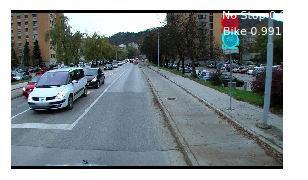
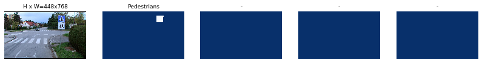
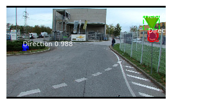
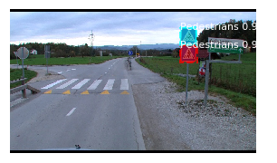
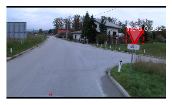
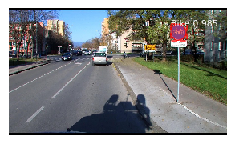
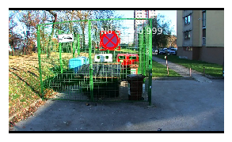

# Traffic Signs Detection And Recognition
*Course project · Selected Topics in Intelligent Systems 1 · [Afeka Tel Aviv Academic College of Engineering](https://www.afeka.ac.il/) · 2021*
### Topic: Intelligent transportation systems

Implementation of traffic-sign detection and recognition using Mask R-CNN network.<br/>
**Dataset:** DFG Traffic Sign Dataset - traffic signs images in JPEG format.<br/>
**Programming Language:** Python 3.<br/>
**Technologies/Methods:** Mask R-CNN (mrcnn 0.2).<br/>
**Software:** Spyder 3.3.6 / IPython 7.8.0 – development environment.<br/>
&emsp;&emsp;VGG Image Annotator - an image annotation tool that can be used to<br/>
&emsp;&emsp;define regions in an image and create textual descriptions of those regions.



## Data

Five sign classes were selected from the DFG Traffic Sign Dataset and annotated manually
with polygon masks in VGG Image Annotator (exported to COCO format).

| Class | Train instances | Val instances |
|---|---:|---:|
| Yield | 14 | 6 |
| Direction | 15 | 8 |
| No Stop | 12 | 8 |
| Bike | 13 | 8 |
| Pedestrians | 16 | 6 |
| **Total** | **70** (62 images) | **36** (31 images) |

A separate set of 23 unannotated images (`datasets/traffic_signs/real_test`) was used for visual testing.
Images were resized to 768×448.

Example of a training image with its ground-truth mask:



## Training

- Model: Mask R-CNN, ResNet-50 backbone, initialized from MS COCO weights.
- Stage 1: network heads only, 4 epochs × 500 steps, learning rate 0.001.
- Stage 2: all layers, 4 more epochs × 500 steps, learning rate 0.0001.
- Batch size 1, trained on CPU: about 124 min for stage 1 and 182 min for stage 2.
- Detection confidence threshold at inference: 0.85.

Loss per epoch (taken from `Run Results.html`):

| Epoch | Layers | Train loss | Val loss |
|---:|---|---:|---:|
| 1 | heads | 1.026 | 1.535 |
| 2 | heads | 0.320 | 0.591 |
| 3 | heads | 0.188 | 1.046 |
| 4 | heads | 0.135 | 0.464 |
| 5 | all | 0.070 | 1.036 |
| 6 | all | 0.060 | 0.567 |
| 7 | all | 0.052 | 9.372 |
| 8 | all | 0.049 | 0.901 |

Training loss decreases steadily. Validation loss is noisy because only 5 validation steps
are evaluated per epoch (`VALIDATION_STEPS = 5`), which also explains the spike at epoch 7. The gap between training and validation loss indicates overfitting,
which is expected with 62 training images.

## Results

Examples of detections on the test images (class name and confidence score):

| | |
|:---:|:---:|
|  |  |
|  |  |

Signs from the five trained classes were detected with confidence scores of about 0.98–0.99.

Known errors:
- Some signs that do not belong to the five trained classes are detected as one of them.
- Very small signs are not detected.
- Some masks extend beyond the sign, for example:



**Limitations.** mAP was not computed: the test images have no ground-truth annotations,
and the validation set is too small for a reliable number. To compute mAP, annotate the
`real_test` images and evaluate them with `mrcnn.utils.compute_ap`.

## Lessons learned

The model architecture was taken off the shelf; most of the work, and most of the
remaining problems, are in the data:

- **Annotation matters more than the model.** All 106 sign instances were annotated
  manually with polygon masks in VGG Image Annotator. Consistent annotation rules
  (what counts as a sign, how to handle partly hidden signs) directly affect mask quality.
- **Negative examples are needed.** Signs outside the five trained classes were often
  detected as one of them, because the training set contained almost no other signs.
  Adding images with other signs labeled as background would reduce these false positives.
- **Small objects need dedicated data.** Very small signs were missed. The training set
  should include more distant signs, or images should be processed at a higher resolution.
- **Evaluation needs annotated test data.** The test images were checked visually only,
  so no mAP could be reported. The validation loss was also noisy because only
  5 validation steps were run per epoch. A small annotated test set would give a
  reliable metric.
- **62 training images are enough for a proof of concept, not for production.**
  Training loss kept falling while validation loss did not, which is a sign of overfitting.
  More data and augmentation (brightness, blur, scale) would be the next step.

## How to run

```bash
pip install -r requirements.txt
python MaskRCNN_TrainAndInference.py
```

Requires Python 3.7 and TensorFlow 1.x (mrcnn 0.2 does not support TensorFlow 2).
COCO weights (`mask_rcnn_coco.h5`) are downloaded automatically on the first run.
Logs and trained models are saved to `logs/`. Set the `MASK_RCNN_DIR` environment
variable to keep them in another folder.

## Project files
* *Deep Learning for Large-Scale Traffic-Sign Detection and Recognition - Presentation.pptx* - seminar presentation reviewing the article
  [Deep Learning for Large-Scale Traffic-Sign Detection and Recognition](https://arxiv.org/abs/1904.00649)
  (D. Tabernik, D. Skočaj, IEEE Transactions on Intelligent Transportation Systems).<br/>
* *Deep Learning for Large-Scale Traffic-Sign Detection and Recognition - Report.pdf* - project report.<br/>
* *resize_images.py* - Python code for images resizing.<br/>
* *MaskRCNN_TrainAndInference.py* - Python code for creation/training/testing of the model.<br/>
* *Run Results.html* - results of model creation, training and testing.<br/>

See the document *"Deep Learning for Large-Scale Traffic-Sign Detection and Recognition - Report.pdf"* <br/>
the part *"Traffic Signs Recognition Project"* for the project implementation details.<br/>

## Credits and license

- Images are from the [DFG Traffic Sign Dataset](https://www.vicos.si/resources/dfg/)
  (D. Tabernik, D. Skočaj), licensed under
  [CC BY-NC-SA 4.0](https://creativecommons.org/licenses/by-nc-sa/4.0/).
  The images and annotations in `datasets/` are distributed under the same license.
- Model implementation: [Matterport Mask R-CNN](https://github.com/matterport/Mask_RCNN) (MIT license).
- The training script is adapted from the Immersive Limbo tutorial on training Mask R-CNN
  on a custom COCO-like dataset.
- The code in this repository is licensed under the [MIT License](LICENSE).
